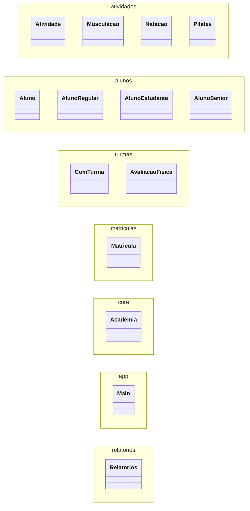

# 🏋️ Sistema Academia — Grupo 4

**Projeto de Programação Orientada a Objetos (POO)**  
**IFMA · Ciência da Computação · 2026.2**

Este repositório reúne o desenvolvimento colaborativo de um sistema de gerenciamento de academia, organizado em pacotes Java por área de responsabilidade.

## ▶️ Como executar

**Pré-requisito:** JDK 17 ou superior.

Na raiz do repositório, compile todos os arquivos Java:

```bash
javac -d out $(find src -name "*.java")
```

Depois, execute a classe principal:

```bash
java -cp out app.Main
```

> **Importante:** os arquivos devem declarar o pacote correspondente à sua pasta (`package app;`, `package alunos;` etc.). O comando de execução pressupõe que `Main.java` declara `package app;` e contém o método `public static void main(String[] args)`.

## 👥 Divisão de responsabilidades

| Integrante | GitHub | Pacote(s) |
|---|---|---|
| Gabriel S | [@putrefascia](https://github.com/putrefascia) | `atividades/` |
| Anna Júlia | [@janna-juu](https://github.com/janna-juu) | `alunos/` |
| Erasmo | [@ErasmoPereira0708](https://github.com/ErasmoPereira0708) | `turmas/` |
| Marco Antônio | [@Kratonz-21](https://github.com/Kratonz-21) | `matriculas/` |
| Lucas Fontes | [@lfonteskayn](https://github.com/lfonteskayn) | `core/` |
| Marcos Chagas | [@morgana-boop](https://github.com/morgana-boop) | `app/` e `relatorios/` |

## 📁 Estrutura do projeto

```text
poo-2026-2-grupo-4/
├── src/
│   ├── atividades/              # Gabriel S
│   │   ├── Atividade.java
│   │   ├── Musculacao.java
│   │   ├── Natacao.java
│   │   └── Pilates.java
│   │
│   ├── alunos/                  # Anna Júlia
│   │   ├── Aluno.java
│   │   ├── AlunoRegular.java
│   │   ├── AlunoEstudante.java
│   │   └── AlunoSenior.java
│   │
│   ├── turmas/                  # Erasmo
│   │   ├── ComTurma.java
│   │   └── AvaliacaoFisica.java
│   │
│   ├── matriculas/              # Marco Antônio
│   │   └── Matricula.java
│   │
│   ├── core/                    # Lucas Fontes
│   │   └── Academia.java
│   │
│   ├── app/                     # Marcos Chagas
│   │   └── Main.java
│   │
│   └── relatorios/              # Marcos Chagas
│       └── Relatorios.java
│
├── .github/
│   └── workflows/
│       └── ci.yml
├── .gitignore
└── README.md
```

## 🧩 Diagrama de classes (estrutura preliminar)



> Este diagrama identifica as classes previstas e seus pacotes. As relações UML (herança, associação, composição e dependência) devem ser acrescentadas após a definição das classes e de suas interfaces, para não presumir vínculos ainda não implementados.

## 🤖 Declaração de uso de IA

O **Gemini** foi utilizado como ferramenta de apoio à organização do projeto e à distribuição das responsabilidades entre os integrantes, com base nos requisitos apresentados pelo professor.
